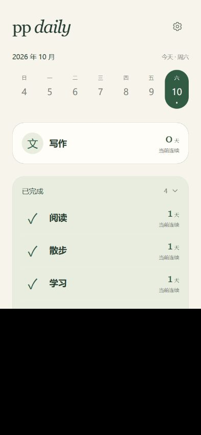

# pp Daily

[中文](README.md) | [English](README.en.md)

[](https://github.com/PPPPeric/pp-daily/actions/workflows/ci.yml)

面向 iPhone 15 的个人每日打卡 PWA，采用 Vue 3、FastAPI 和 SQLite，支持离线记录、私人网络同步和备份恢复。

## 项目架构

```text
iPhone 15 PWA（Vue 3 + TypeScript）
  ├─ IndexedDB：本地数据副本和待同步完成记录
  └─ Tailscale 私人 HTTPS
       └─ Mac mini：FastAPI（127.0.0.1:8000）
            ├─ 前端静态文件
            └─ SQLite：项目、完成记录和备份
```

前端和 API 使用同一地址。完成操作先写入 IndexedDB，联网后同步至 SQLite；项目与日期的唯一键避免重复计数。恢复备份会更换数据版本，阻止旧设备将待同步记录写回恢复后的数据库。Windows 用于开发，Mac mini 提供持续运行的私人服务。

## 设备支持

第一版以 **iPhone 15、iOS 17+ 的 Safari 和主屏幕 PWA** 为验收目标，优先竖屏使用。开发检查采用 393 × 852 CSS 像素，横屏也保留基本可用布局；不进行机型识别或锁定屏幕像素。现有响应式布局成本很低，可继续用于 Windows 开发预览，其他手机暂不承诺专项适配。

界面处理动态高度、顶部和底部安全区域、横屏左右安全区及至少 44 CSS 像素的操作目标。浏览器尺寸检查不等于 iPhone 真机验证；真机验收清单见 [iPhone 15 验收说明](docs/iphone15.md)。界面目前为中文，英文支持指项目文档。



## 功能

- 今日：切换最近七天查看记录；项目显示默认头像与当前连续天数。整行向右滑动约 120 像素后松手完成，短滑自动复位；已完成项目移到下方独立栏。历史日期只读，每项目每天只可完成一次；点击不会完成。没有取消、补打、时长或暂停。
- 月历：选择一个项目，按月只读查看完成记录。未来、创建前、归档后不适用。
- 统计：累计完成天数、本月完成天数、当前连续天数、最长连续天数。
- 管理：在线新建、改名、选择颜色、排序、不可逆归档；保留历史记录。
- 离线：IndexedDB 保存记录，Service Worker 保存页面，启动/回前台/联网/每 30 秒自动尝试同步。不承诺关闭 App 后后台同步。
- 备份：导出完整 JSON（含本地未同步记录），在线恢复整库；服务器自动保留恢复前 JSON。

固定 Asia/Shanghai 时区。今天没完成时当前连续天数算到昨天；归档项目算到归档当天。归档当天已有的离线记录仍允许同步，此后日期不能完成。

## Windows 开发

要求 Python 3.12+、Node.js 22.12+。在项目目录执行：

```powershell
.\scripts\dev.ps1
```

打开 http://127.0.0.1:8000 即为生产构建的本地预览，可验证 Service Worker。首次打开需要网络加载。脚本优先使用当前 Codex 自带 Python，其次使用 `py` 或 `python`；也可通过 `-PythonExecutable 'C:\Python312\python.exe'` 指定解释器。

需要热更新时，另开终端：

```powershell
cd frontend
npm run dev
```

Vite http://127.0.0.1:5173 代理 `/api` 到后端。开发模式不注册离线缓存。

## 测试

```powershell
.venv\Scripts\python.exe -m pytest backend\tests -q
cd frontend
npm test
npm run build
```

依赖锁：前端 `package-lock.json`；后端 `requirements.txt` 固定直接依赖。不要复制 Windows 的 `.venv` 或 `node_modules` 到 Mac。

## Mac mini 部署

1. 将本项目源代码复制到 Mac 的固定目录，例如 `~/Applications/pp-daily`。安装 Python 3.12+、Node.js 22.12+ 和 Tailscale。
2. 在 Mac 和 iPhone 的 Tailscale 使用自己的账号，连接同一 tailnet；通过设备/ACL 只允许自己的设备访问此服务。
3. 在 Mac 项目目录执行 `bash scripts/install-macos.sh`。该脚本构建前端并安装两个用户级 LaunchAgent：服务自动重启；每天 03:00 做 SQLite 一致性备份，保留最新 30 份。用户登录后运行，机器重启后也需用户登录。
4. 执行 `tailscale serve --bg http://127.0.0.1:8000`，按照 Tailscale 提示启用 tailnet HTTPS，使用命令返回的固定 `https://机器名.tailnet名.ts.net` 地址。运行 `tailscale serve status` 核查。只使用 Serve；不得开启 Funnel 或路由器公网端口转发。
5. 关闭 Mac 自动睡眠并保持联网。检查 `data/logs/`，确认服务与定时备份正常。运行 `curl http://127.0.0.1:8000/api/state` 验证接口。
6. iPhone 打开 Tailscale，再用 Safari 打开固定 HTTPS 地址；分享 → 添加到主屏幕，名称默认「pp Daily」。应看到墨绿双 p 图标。

Tailscale Serve 官方说明：https://tailscale.com/docs/reference/tailscale-cli/serve
本地后端只监听 127.0.0.1，不包含登录和公网防护；访问控制由 tailnet 权限负责。

## 更新

先运行一次备份，将新源代码放回同一目录，再执行安装脚本。保留 `data/`，不要覆盖数据库。PWA 新版本下载完成后，关闭所有旧页面并重新打开，新的缓存会激活。未来数据库结构升级需先备份并实现迁移。

## 备份与恢复

```bash
.venv/bin/python scripts/backup.py --database data/pp-daily.sqlite3 --destination data/backups
```

SQLite backup API 可在服务运行中获得一致性备份，避免直接复制正在写入的数据库。将 `data/backups/` 至少复制一份到 Mac 之外；此项目不自动接入 iCloud 或其他云盘。

日常恢复：管理 → 恢复备份 → 选择 JSON → 确认替换。服务端验证版本、项目关联、重复记录和日期后再事务替换。恢复前文件保存在 `data/backups/before-restore-*.json`；这些安全备份不随每日 30 份清理规则删除。

整机故障：停止服务，将一份 `.sqlite3` 一致性备份替换为 `data/pp-daily.sqlite3`，重启。随后在管理中再次导出并恢复 JSON，让数据世代更新，防止旧客户端误上传。恢复后所有设备先导出本地备份，再选择“重新载入”。

## 同步规则与边界

完成先写入 IndexedDB，成功保存后才显示完成；网络失败保留队列。Web Locks 在支持的浏览器中串行化同源标签页操作，SQLite 唯一键负责最终去重。服务器验证日期与操作时刻一致，接受合法延迟上传。单人无登录服务无法证明离线客户端时钟真实，因此不能防止手工伪造请求；页面没有历史写入入口。

恢复生成新的数据世代。旧设备同步收到冲突后停止上传，并提示先导出本地备份，重新载入服务器副本。旧队列不会悄悄写回恢复后的库。恢复为显式整库替换，没有自动合并历史备份的功能。

首次加载、换手机和项目管理需服务在线。浏览器清除网站数据会丢失未同步记录，需定期检查“已同步”并导出备份。设备日期异常会导致上传被拒绝，页面保留记录并显示原因。

## iPhone 真机验收

- 从主屏幕打开，图标、名称、刘海与底部安全区正确。
- 创建项目并完成；重复点击不能增加记录，月历/统计一致。
- 首次联网缓存完成后断开网络，打卡；关闭再打开，记录仍在。
- 恢复 Tailscale，回到 App，同步状态变为已同步，Mac 有记录。
- 跨上海零点，前台页面在 30 秒内切换新一天；离线旧记录仍归属旧日期。
- 导出 JSON，在干净数据环境恢复，项目、颜色、顺序、归档和记录一致。
- Mac 重启并登录后，服务与 Serve 可访问，备份任务产出新文件。

开发计划见 `docs/plans/2026-10-10-pp-daily.md`。Mac 与 iPhone 真机验收需在对应设备完成。

## 项目结构

```text
backend/           FastAPI、SQLite 和接口测试
frontend/          Vue 3、TypeScript、IndexedDB、PWA 和前端测试
scripts/           Windows 开发、Mac 安装、备份和图标生成
docs/              开发计划、验证记录、iPhone 验收及示例截图
.github/           CI、问题模板和 PR 模板
```

## GitHub 与维护

公开仓库只包含代码、文档和示例图片。`.venv`、`node_modules`、构建目录、SQLite、备份、凭据和个人记录不进入 Git。GitHub Actions 在 push / PR 时运行后端测试、前端测试、类型检查、生产构建和基础脚本检查；不自动部署，也不把个人服务公开。

贡献前请阅读 [CONTRIBUTING.md](CONTRIBUTING.md)，私人部署和报告问题的边界见 [SECURITY.md](SECURITY.md)。当前验证结果见 [VERIFICATION.md](docs/VERIFICATION.md)。

## 许可证

维护者尚未选择开源许可证。公开仓库便于查看和按 GitHub 平台条款 fork，不表示已授予 MIT 或其他开源许可。详见 [GitHub 许可证说明](https://docs.github.com/en/repositories/managing-your-repositorys-settings-and-features/customizing-your-repository/licensing-a-repository)。

### 项目文字图标

创建或编辑项目时可设置一个字作为图标；留空时显示项目名称的第一个字。图标文字与项目颜色一起同步，并包含在备份中。旧项目和旧备份会自动使用名称首字。
